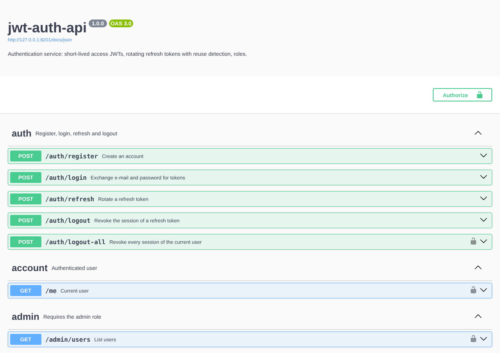

# jwt-auth-api

An authentication service in Node.js and TypeScript, ready to sit in front of a web or mobile
app. Users register and log in with a bcrypt-hashed password, receive a short-lived access JWT
and a refresh token that rotates on every use. Refresh tokens are stored only as hashes in
SQLite, and if an old token is ever presented again the whole session is revoked (reuse
detection). Every route is validated with JSON Schema and documented with OpenAPI.

Maintained by [GonService](https://gonserviceit.com.br/software-sob-demanda) · [Português](#em-português)



## Features

| Feature | How |
| --- | --- |
| Password storage | bcrypt (configurable cost), constant-time login: unknown e-mails are compared against a dummy hash |
| Access token | JWT HS256, 15 minutes by default, `sub` + `role` claims, issuer checked on verify |
| Refresh token | 256-bit opaque token, single use, stored as SHA-256 hash, rotated on `/auth/refresh` |
| Reuse detection | Presenting an already rotated token revokes every token of that session |
| Logout | `/auth/logout` revokes one session, `/auth/logout-all` revokes all of them |
| Roles | `user` and `admin` (granted to `ADMIN_EMAILS`); `/admin/users` returns 403 for regular users |
| Brute force | Login rate limited per IP + e-mail (5 per minute by default), returns 429 |
| Validation | JSON Schema on every body, unknown fields stripped, so clients cannot choose their role |
| Docs | OpenAPI 3 at `/docs/json`, Swagger UI at `/docs` |
| Stack | Node 22, TypeScript (strict), Fastify 5, @fastify/jwt, better-sqlite3, bcryptjs, Vitest |

## How to use

### Run locally

```bash
npm ci
export JWT_SECRET=$(openssl rand -hex 32) ADMIN_EMAILS=admin@example.com
npm run dev                 # http://localhost:8080, docs at http://localhost:8080/docs
```

For production: `npm run build && npm start`.

### Run with Docker

```bash
docker build -t jwt-auth-api .
docker run -d --name auth -p 8080:8080 -v auth-data:/data \
  -e JWT_SECRET=$(openssl rand -hex 32) -e ADMIN_EMAILS=admin@example.com jwt-auth-api
```

The image runs as a non-root user, keeps the database in the `/data` volume and has a
`HEALTHCHECK` on `/healthz`.

### Try the flow with curl

```bash
# 1. Register (the e-mail in ADMIN_EMAILS becomes admin)
curl -s -X POST localhost:8080/auth/register -H 'content-type: application/json' \
  -d '{"email":"admin@example.com","password":"correct horse battery","name":"Admin"}'

# 2. Log in and keep the tokens
TOKENS=$(curl -s -X POST localhost:8080/auth/login -H 'content-type: application/json' \
  -d '{"email":"admin@example.com","password":"correct horse battery"}')
ACCESS=$(echo "$TOKENS" | jq -r .accessToken)
REFRESH=$(echo "$TOKENS" | jq -r .refreshToken)

# 3. Call protected routes
curl -s localhost:8080/me -H "authorization: Bearer $ACCESS"
curl -s localhost:8080/admin/users -H "authorization: Bearer $ACCESS"

# 4. Rotate the refresh token (the old one stops working)
curl -s -X POST localhost:8080/auth/refresh -H 'content-type: application/json' \
  -d "{\"refreshToken\":\"$REFRESH\"}"

# 5. Log out
curl -s -X POST localhost:8080/auth/logout -H 'content-type: application/json' \
  -d "{\"refreshToken\":\"$REFRESH\"}"
```

### Routes

| Method | Path | Auth | Description |
| --- | --- | --- | --- |
| POST | `/auth/register` | - | Create an account (`email`, `password` 10-128 chars, `name`) |
| POST | `/auth/login` | - | Returns `accessToken`, `refreshToken`, `expiresIn` |
| POST | `/auth/refresh` | refresh token | New token pair, invalidates the one sent |
| POST | `/auth/logout` | refresh token | Revokes that session |
| POST | `/auth/logout-all` | Bearer | Revokes every session of the user |
| GET | `/me` | Bearer | Current user and number of active sessions |
| GET | `/admin/users` | Bearer, admin | Lists users |
| GET | `/healthz`, `/docs` | - | Health check, Swagger UI |

### Configuration

| Variable | Description | Default |
| --- | --- | --- |
| `JWT_SECRET` | HMAC secret for access tokens (min. 32 chars) | required |
| `JWT_ISSUER` | `iss` claim, checked on verify | `jwt-auth-api` |
| `ACCESS_TTL_SECONDS` | Access token lifetime | `900` |
| `REFRESH_TTL_DAYS` | Refresh token lifetime | `30` |
| `BCRYPT_ROUNDS` | bcrypt cost factor | `12` |
| `LOGIN_MAX_ATTEMPTS` / `LOGIN_WINDOW_MS` | Login rate limit per IP + e-mail | `5` / `60000` |
| `ADMIN_EMAILS` | Comma-separated e-mails that register as admin | empty |
| `DB_PATH` / `PORT` | SQLite file / HTTP port | `data/auth.db` / `8080` |

### Tests

```bash
npm test            # 23 tests: hashing, login, rate limit, rotation, reuse detection, roles, docs
npm run typecheck
```

## Em português

API de autenticação em Node.js e TypeScript: cadastro e login com senha protegida por bcrypt,
token de acesso JWT de curta duração e refresh token que é trocado a cada uso e guardado apenas
como hash no SQLite. Se um refresh token antigo for reutilizado (sinal de roubo), toda a sessão é
revogada. Inclui logout de uma sessão ou de todas, perfis de acesso (usuário e administrador),
limite de tentativas de login e documentação OpenAPI com Swagger UI em `/docs`.

Para usar: `npm ci`, defina `JWT_SECRET` (por exemplo `openssl rand -hex 32`) e rode
`npm run dev`, ou suba com Docker usando os comandos acima. Os exemplos com `curl` mostram o
fluxo completo de cadastro, login, rota protegida, renovação e logout.

Precisa de login seguro para o seu sistema ou aplicativo? A GonService faz:
[gonserviceit.com.br/software-sob-demanda](https://gonserviceit.com.br/software-sob-demanda) ·
[contato@gonserviceit.com.br](mailto:contato@gonserviceit.com.br)

## License

[MIT](../LICENSE)
