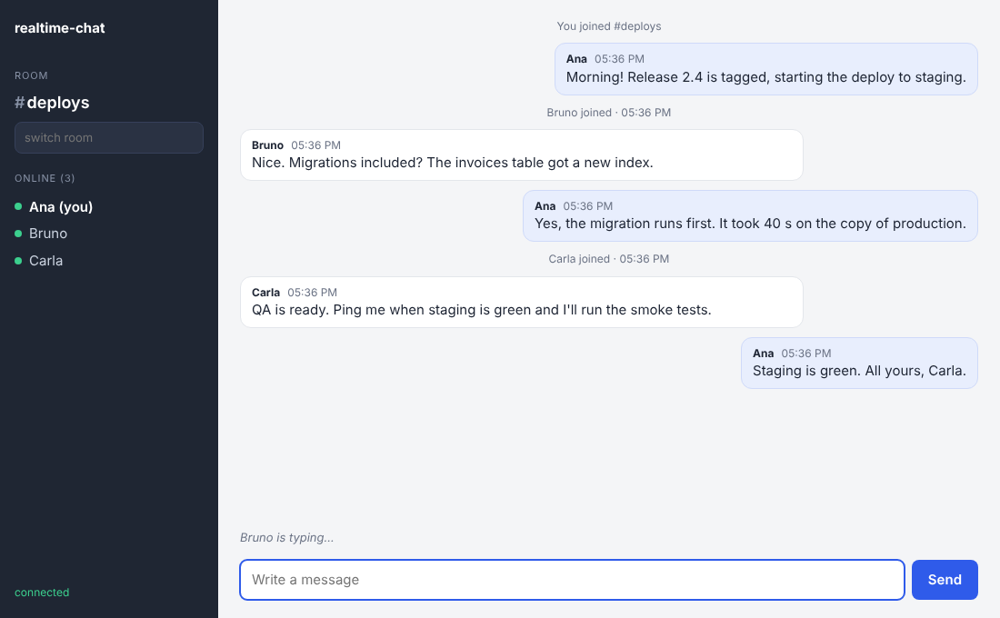

# realtime-chat

A real-time chat server in Node.js and TypeScript over WebSockets. People pick a nickname, join
a room and talk: join and leave events, who is online, a typing indicator and the last 50
messages of the room for whoever arrives. Each connection has flood protection, dead
connections are dropped by a ping heartbeat, and a minimal HTML/JS client is served by the
same process. It is the base for support chats, internal team rooms or live notifications.

Maintained by [GonService](https://gonserviceit.com.br/software-sob-demanda) · [Português](#em-português)



## Features

| Feature | How |
| --- | --- |
| Rooms | `a-z`, `0-9` and `-`, created on first join; switching rooms is another `join` |
| Nicknames | 2-24 characters (Unicode letters allowed), unique per room, case-insensitive |
| Presence | `presence` events with the updated member list on every join and leave |
| Typing indicator | Relayed to the other members only; the client hides it after 4 s or on the next message |
| History | Last 50 messages per room (configurable), sent in the `joined` event |
| Flood protection | Token bucket per connection (burst 5, 1 msg/s), `rate_limited` errors, close code `1008` after 10 violations; typing has its own silent budget; 8 KB max frame |
| Heartbeat | Ping every 30 s, connections that miss a pong are terminated |
| Client | Static HTML/CSS/JS in `public/`, auto-reconnect with backoff, no build step |
| Stack | Node 22, TypeScript (strict), Fastify 5, @fastify/websocket (ws), Vitest |

## How to use

### Run locally

```bash
npm ci
npm run dev                 # open http://localhost:8080 in two browser windows
```

For production: `npm run build && npm start`. Link straight to a room with
`http://localhost:8080/?room=support`.

### Run with Docker

```bash
docker build -t realtime-chat .
docker run -d --name chat -p 8080:8080 realtime-chat
```

The image runs as a non-root user and has a `HEALTHCHECK` on `/healthz`. Behind a reverse proxy,
forward the `Upgrade` and `Connection` headers for `/ws`.

### Talk to it from the terminal

```bash
npx wscat -c ws://localhost:8080/ws
> {"type":"join","room":"general","nick":"ops-bot"}
< {"type":"joined","room":"general","nick":"ops-bot","members":["ops-bot"],"history":[]}
> {"type":"message","text":"backup finished in 4m12s"}
< {"type":"message","id":"...","room":"general","nick":"ops-bot","text":"backup finished in 4m12s","at":"..."}

curl -s localhost:8080/api/rooms     # {"rooms":[{"room":"general","members":1}]}
```

### Protocol

All frames are JSON text on `ws://host/ws`.

| Direction | Frame | Notes |
| --- | --- | --- |
| client → server | `{"type":"join","room","nick"}` | Join or switch room |
| client → server | `{"type":"message","text"}` | 1-1000 characters, trimmed |
| client → server | `{"type":"typing","typing":true}` | `false` when the input is cleared |
| client → server | `{"type":"leave"}` | Leave the room without disconnecting |
| server → client | `joined` | `room`, `nick`, `members`, `history` |
| server → client | `presence` | `event` (`join`/`leave`), `nick`, `members`, `at` |
| server → client | `message` | `id`, `room`, `nick`, `text`, `at` |
| server → client | `typing` | `nick`, `typing` |
| server → client | `error` | `code`: `invalid_room`, `invalid_nick`, `nick_taken`, `not_joined`, `rate_limited`, ... |

### Configuration

| Variable | Description | Default |
| --- | --- | --- |
| `HISTORY_SIZE` | Messages kept per room (max. 500) | `50` |
| `FLOOD_BURST` / `FLOOD_REFILL_PER_SECOND` | Token bucket per connection | `5` / `1` |
| `FLOOD_MAX_VIOLATIONS` | Rate-limit hits before closing with `1008` | `10` |
| `MAX_MESSAGE_LENGTH` | Characters per message | `1000` |
| `HEARTBEAT_MS` | Ping interval | `30000` |
| `PORT` / `HOST` | HTTP port / bind address | `8080` / `0.0.0.0` |

History is kept in memory, so it resets when the process restarts; run one instance (or add a
shared store such as Redis pub/sub) if you need to scale out.

### Tests

```bash
npm test            # 13 tests, most of them over real WebSocket connections
npm run typecheck
```

## Em português

Servidor de chat em tempo real com WebSocket, em Node.js e TypeScript: salas, apelidos, avisos de
entrada e saída, lista de quem está online, indicador de "digitando", histórico das últimas 50
mensagens de cada sala e proteção contra flood (limite de mensagens por conexão e desconexão de
quem insiste). Inclui um cliente web simples em HTML e JavaScript, servido pelo próprio servidor.

Para usar: `npm ci && npm run dev` e abra `http://localhost:8080` em duas janelas do navegador,
ou suba com Docker usando os comandos acima. Também é possível conversar pelo terminal com
`npx wscat -c ws://localhost:8080/ws`, seguindo o protocolo descrito na tabela.

Precisa de chat, atendimento ou notificações em tempo real no seu sistema? A GonService faz:
[gonserviceit.com.br/software-sob-demanda](https://gonserviceit.com.br/software-sob-demanda) ·
[contato@gonserviceit.com.br](mailto:contato@gonserviceit.com.br)

## License

[MIT](../LICENSE)
