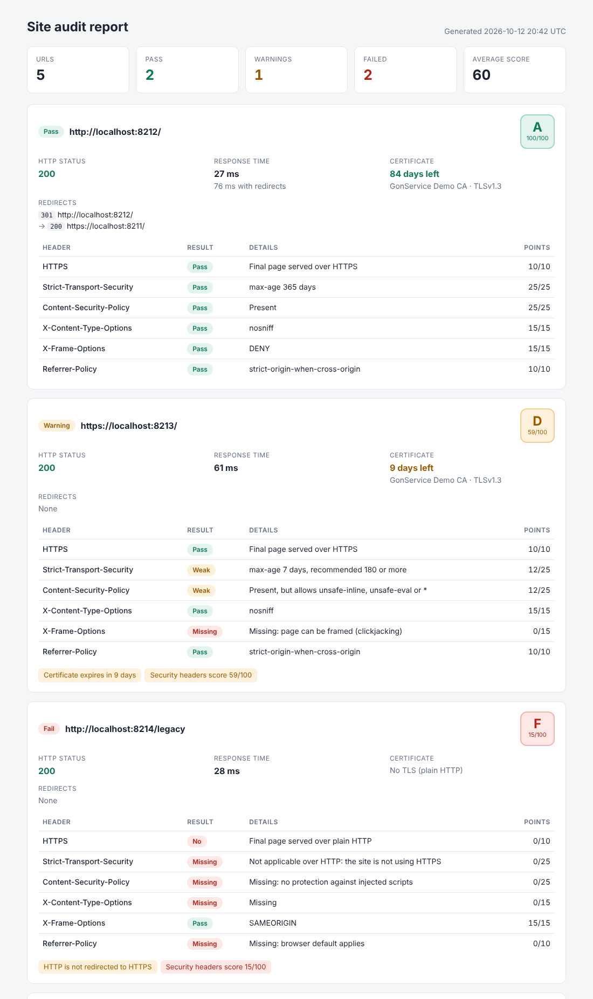

# site-audit-cli

A command-line tool in Node.js and TypeScript that audits a list of URLs and tells you what
needs attention: HTTP status and redirect chain, response time, TLS certificate (days left,
issuer, whether it is trusted) and the security headers browsers rely on, with a 0-100 score.
It prints a summary table, writes a self-contained HTML report and a JSON file, and returns a
non-zero exit code on failures, so it fits in a cron job or a CI pipeline. No runtime
dependencies: only Node's own `http`, `https` and `tls` modules.

Maintained by [GonService](https://gonserviceit.com.br/software-sob-demanda) · [Português](#em-português)



*Report generated against the local test servers (certificates issued by a throwaway CA).*

## Features

| Check | How |
| --- | --- |
| Status and redirects | Redirects followed one by one (up to `--max-redirects`), every hop recorded; 4xx/5xx fail; HTTP not upgraded to HTTPS warns |
| Response time | Time to headers of the final page, plus total time with redirects; slow pages (> 1.5 s) warn |
| TLS certificate | Days left, issuer, subject, protocol; untrusted chain or wrong host fails, expiry under `--warn-days` warns |
| Security headers | `Strict-Transport-Security` (25), `Content-Security-Policy` (25), `X-Content-Type-Options` (15), `X-Frame-Options` or CSP `frame-ancestors` (15), `Referrer-Policy` (10), HTTPS (10) |
| Weak values | Short HSTS `max-age`, CSP with `unsafe-inline`/`unsafe-eval`/`*` and leaky referrer policies get half the points |
| Output | Terminal table, `report.html` (inline CSS, no scripts or external requests), `report.json` |
| Automation | Exit code `1` on failures or `--fail-under <score>`, `2` on usage errors; URLs from a file; parallel checks |
| Stack | Node 22, TypeScript (strict), zero runtime dependencies, Vitest |

## How to use

### Install and run

```bash
npm ci && npm run build
npx site-audit https://example.com example.org http://example.net/old-page
```

URLs without a scheme get `https://`. To have `site-audit` on your PATH, run `npm link` (or
`npm install -g .`) in this folder. Output:

```text
RESULT  HTTP  TIME   TLS  SCORE  URL
PASS    200   85ms   84d  A 100  https://shop.example.com/
WARN    200   49ms   9d   D 59   https://blog.example.com/
FAIL    200   7ms    -    F 15   http://legacy.example.com/

3 URLs: 1 pass, 1 warning, 1 failed · average score 58
Report: /home/me/site-audit-report/report.html
```

### More examples

```bash
# URLs from a file (one per line, # for comments), reports in ./reports
npx site-audit --file urls.txt --out reports

# CI gate: fail the build if any site scores below 75
npx site-audit https://staging.example.com --fail-under 75

# Internal sites signed by your own CA, certificate warning 30 days ahead
npx site-audit https://intranet.local --ca ./company-ca.pem --warn-days 30

# JSON on stdout for other tools
npx site-audit https://example.com --json | jq '.results[0].tls'
```

### Run with Docker

```bash
docker build -t site-audit .
docker run --rm --user "$(id -u):$(id -g)" -v "$PWD:/work" site-audit https://example.com --out /work/site-audit-report
```

The image contains only the compiled JavaScript and runs as a non-root user.

### Options

| Option | Description | Default |
| --- | --- | --- |
| `-f, --file <path>` | Read URLs from a file | - |
| `-o, --out <dir>` | Directory for `report.html` and `report.json` | `site-audit-report` |
| `--timeout <ms>` | Timeout per request | `10000` |
| `--max-redirects <n>` | Redirects to follow | `5` |
| `--concurrency <n>` | URLs checked in parallel | `4` |
| `--ca <path>` | Extra trusted CA certificate (PEM), repeatable | - |
| `--warn-days <n>` | Certificate expiry warning threshold | `21` |
| `--fail-under <n>` | Exit 1 if any security score is below `n` | - |
| `--json` | Print the JSON report instead of the table | off |

### Tests

```bash
npm test            # 20 tests against local HTTP and HTTPS servers, no internet needed
npm run typecheck
```

The tests create a certificate authority and server certificates at run time (trusted,
self-signed and about to expire), start local servers with different headers, redirects,
loops and timeouts, and run the CLI end to end.

## Em português

Ferramenta de linha de comando em Node.js e TypeScript que verifica uma lista de sites: código
HTTP e redirecionamentos, tempo de resposta, certificado TLS (dias até vencer, emissor e se é
confiável) e os cabeçalhos de segurança (HSTS, CSP, X-Content-Type-Options, X-Frame-Options e
Referrer-Policy), com nota de 0 a 100. Gera um relatório HTML completo em um único arquivo, um
JSON e retorna código de saída diferente de zero quando algo falha, ideal para rodar no cron ou
no pipeline de CI e ser avisado antes do certificado vencer.

Para usar: `npm ci && npm run build` e depois `npx site-audit https://seusite.com.br`. O
relatório fica em `site-audit-report/report.html`. Use `--file` para uma lista de URLs e
`--fail-under` para barrar o deploy quando a nota de segurança cair.

Quer monitorar e reforçar a segurança dos seus sites e servidores? A GonService faz:
[gonserviceit.com.br/software-sob-demanda](https://gonserviceit.com.br/software-sob-demanda) ·
[contato@gonserviceit.com.br](mailto:contato@gonserviceit.com.br)

## License

[MIT](../LICENSE)
