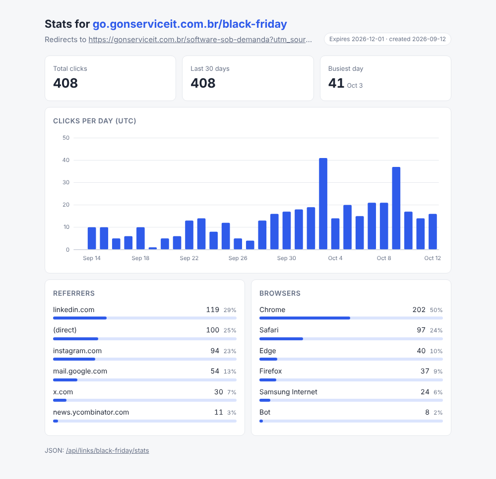

# url-shortener

A self-hosted link shortener in Node.js and TypeScript. Create short links for campaigns,
QR codes or messages, optionally with a custom alias and an expiry date, and see who clicked:
clicks per day, referrer sites and browsers. Everything lives in a single SQLite file, and the
stats page is rendered on the server with a hand-drawn SVG chart (no chart library, no
JavaScript needed).

Maintained by [GonService](https://gonserviceit.com.br/software-sob-demanda) · [Português](#em-português)



## Features

| Feature | How |
| --- | --- |
| Short links | 7-character random slugs without ambiguous characters (`0/O`, `1/l/I`), or a custom alias |
| Validation | Only `http`/`https`, fully qualified host, no embedded credentials, no links to the shortener itself; reserved paths cannot be aliases |
| Expiry | `expiresAt` (ISO date) or `expiresInDays`; expired links answer `410 Gone` |
| Click analytics | Each redirect stores date, referrer host and browser family (Chrome, Safari, Edge, Firefox, bots, curl...) |
| Accurate counts | `302` with `Cache-Control: no-store`; `HEAD` requests from link previews are not counted |
| Stats | JSON at `/api/links/:slug/stats?days=30`, HTML page at `/stats/:slug` |
| Access control | Optional `API_TOKEN` protects creating and deleting links; redirects stay public |
| Stack | Node 22, TypeScript (strict), Fastify 5, better-sqlite3, Vitest |

## How to use

### Run locally

```bash
npm ci
npm run dev                 # http://localhost:8080 (form on the home page)
```

For production: `npm run build && npm start`.

### Run with Docker

```bash
docker build -t url-shortener .
docker run -d --name links -p 8080:8080 -v links-data:/data \
  -e BASE_URL=https://go.example.com -e API_TOKEN=$(openssl rand -hex 16) url-shortener
```

The image runs as a non-root user, keeps the database in the `/data` volume and has a
`HEALTHCHECK` on `/healthz`.

### Examples

```bash
# Create a link with a random slug
curl -s -X POST localhost:8080/api/links -H 'content-type: application/json' \
  -d '{"url":"https://example.com/products/black-friday?utm_source=newsletter"}'

# Custom alias that expires in 30 days (add -H "authorization: Bearer $API_TOKEN" if a token is set)
curl -s -X POST localhost:8080/api/links -H 'content-type: application/json' \
  -d '{"url":"https://example.com/promo","alias":"promo","expiresInDays":30}'
# {"slug":"promo","shortUrl":"http://localhost:8080/promo","statsUrl":"http://localhost:8080/stats/promo",...}

# Follow it (counts a click)
curl -s -o /dev/null -w '%{redirect_url}\n' localhost:8080/promo -H 'referer: https://www.linkedin.com/'

# Statistics as JSON, or open http://localhost:8080/stats/promo in the browser
curl -s 'localhost:8080/api/links/promo/stats?days=7'

# Delete
curl -s -X DELETE localhost:8080/api/links/promo
```

### Routes

| Method | Path | Description |
| --- | --- | --- |
| POST | `/api/links` | Create: `url`, optional `alias`, `expiresAt` or `expiresInDays` (token if configured) |
| GET | `/api/links/:slug` | Link details and total clicks |
| GET | `/api/links/:slug/stats?days=30` | Clicks per day (zero-filled), top referrers and browsers |
| DELETE | `/api/links/:slug` | Delete a link and its clicks (token if configured) |
| GET | `/:slug` | Redirect (`302`), `404` unknown, `410` expired |
| GET | `/stats/:slug` | Server-rendered stats page |
| GET | `/`, `/healthz` | Home page with a form, health check |

### Configuration

| Variable | Description | Default |
| --- | --- | --- |
| `BASE_URL` | Public origin used in `shortUrl` | `http://localhost:$PORT` |
| `API_TOKEN` | Bearer token for create/delete (min. 16 chars) | none (open) |
| `SLUG_LENGTH` | Length of generated slugs | `7` |
| `DB_PATH` / `PORT` | SQLite file / HTTP port | `data/links.db` / `8080` |

### Tests

```bash
npm test            # 32 tests: URL and alias validation, redirects, click stats, expiry, auth, HTML
npm run typecheck
```

## Em português

Encurtador de links próprio em Node.js e TypeScript: cria links curtos para campanhas, QR codes
e mensagens, com apelido personalizado e data de expiração opcionais. Cada clique registra a
data, o site de origem e o navegador, e a página `/stats/:slug` mostra um gráfico de cliques por
dia, desenhado em SVG no servidor, além das principais origens e navegadores. Tudo fica em um
único arquivo SQLite.

Para usar: `npm ci && npm run dev` e crie links pelo formulário em `http://localhost:8080` ou
pela API com os exemplos de `curl` acima. Em produção, use a imagem Docker definindo `BASE_URL`
com o seu domínio e `API_TOKEN` para proteger a criação de links.

Quer medir suas campanhas com links e domínio próprios? A GonService faz:
[gonserviceit.com.br/software-sob-demanda](https://gonserviceit.com.br/software-sob-demanda) ·
[contato@gonserviceit.com.br](mailto:contato@gonserviceit.com.br)

## License

[MIT](../LICENSE)
