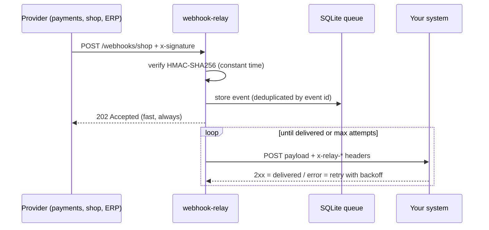

# webhook-relay

A small, reliable webhook gateway in Node.js and TypeScript. It receives webhooks from payment
providers, e-commerce platforms or ERPs, verifies their HMAC signature, stores each event in
SQLite and delivers it to your system with retries and exponential backoff. Nothing is lost if
your system is down for a few minutes.

Maintained by [GonService](https://gonserviceit.com.br/software-sob-demanda) · [Português](#em-português)



## Features

| Feature | How |
| --- | --- |
| Signature check | HMAC-SHA256 (`sha256=<hex>`) over the raw body, constant-time comparison, per-source secret and header |
| Idempotency | Event id from `x-event-id`, `x-request-id`, `x-github-delivery` or `idempotency-key`; payload hash otherwise |
| Durable queue | SQLite in WAL mode: survives restarts, one row per event |
| Retries | Exponential backoff with jitter up to `MAX_ATTEMPTS`, then `failed` for manual replay |
| Admin API | `GET /admin/deliveries?status=failed`, `POST /admin/deliveries/:id/retry` (Bearer token) |
| Observability | `GET /metrics` (Prometheus), `GET /healthz`, structured JSON logs |
| Stack | Node 22, TypeScript (strict), Fastify 5, better-sqlite3, Vitest |

## Run it

```bash
cp .env.example .env        # set ADMIN_TOKEN and your sources
docker compose up -d --build
```

Or without Docker: `npm ci && npm run dev`.

Send a signed test webhook:

```bash
BODY='{"order":42,"status":"paid"}'
SIG="sha256=$(printf '%s' "$BODY" | openssl dgst -sha256 -hmac change-me | awk '{print $2}')"
curl -X POST localhost:8080/webhooks/shop \
  -H 'content-type: application/json' -H "x-signature: $SIG" -H 'x-event-id: evt_42' -d "$BODY"
```

Your target receives the same body with `x-relay-source`, `x-relay-event-id` and
`x-relay-attempt` headers. Answer any 2xx to confirm.

## Configuration

| Variable | Description | Default |
| --- | --- | --- |
| `WEBHOOK_SOURCES` | JSON: `{"name": {"secret", "target", "signatureHeader"?}}` | `{}` |
| `ADMIN_TOKEN` | Bearer token for `/admin` (min. 16 chars) | required |
| `MAX_ATTEMPTS` | Attempts before marking `failed` | `8` |
| `BASE_BACKOFF_MS` | First retry delay; doubles each attempt (max 1 h) | `2000` |
| `DELIVERY_TIMEOUT_MS` | Timeout per delivery | `10000` |
| `DB_PATH` / `PORT` | SQLite file / HTTP port | `data/relay.db` / `8080` |

## Development

```bash
npm ci
npm test            # 17 tests: signatures, API, deduplication, retries, dead letter
npm run typecheck
```

CI runs type checks, tests, builds the image and performs an end-to-end delivery
between two containers.

## Em português

Gateway de webhooks em Node.js e TypeScript: recebe notificações de meios de pagamento, lojas
virtuais e ERPs, valida a assinatura HMAC, guarda cada evento em fila (SQLite) e entrega no seu
sistema com novas tentativas automáticas. Se o seu sistema cair por alguns minutos, nenhum pedido
ou pagamento se perde, e os eventos que falharam podem ser reenviados pela API de administração.

Precisa integrar seu sistema com pagamentos, ERP ou e-commerce? A GonService faz:
[gonserviceit.com.br/software-sob-demanda](https://gonserviceit.com.br/software-sob-demanda) ·
[contato@gonserviceit.com.br](mailto:contato@gonserviceit.com.br)

## License

[MIT](../LICENSE)
